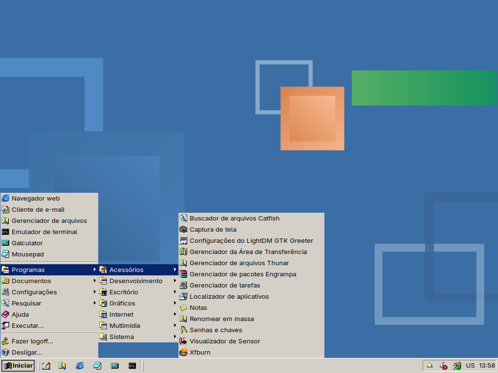
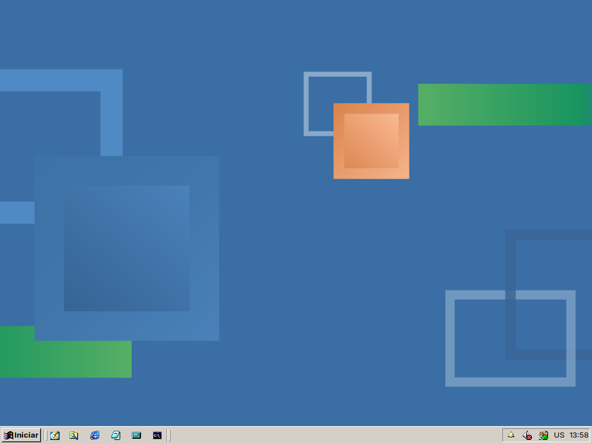
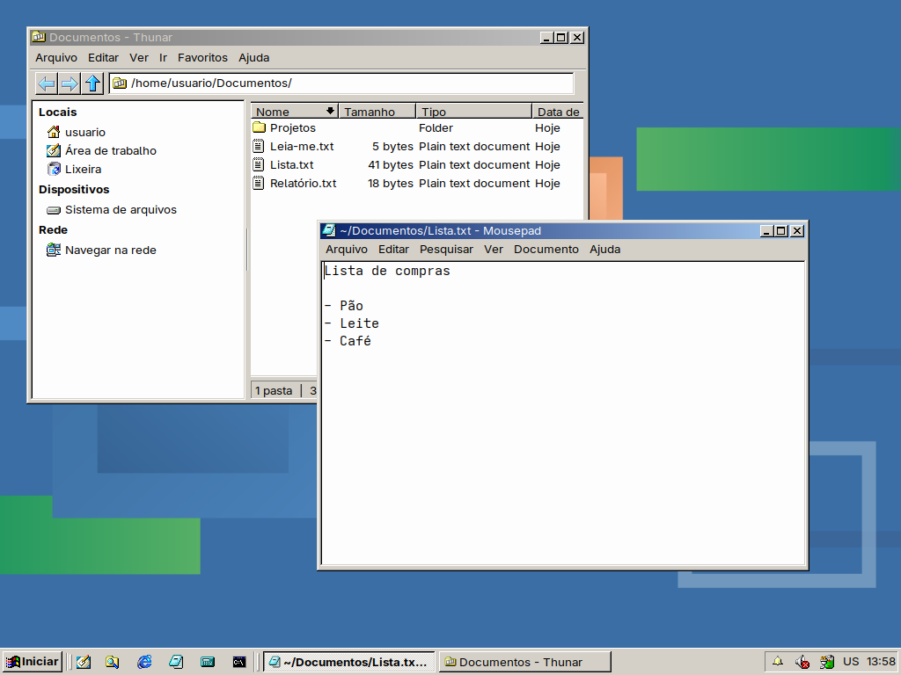
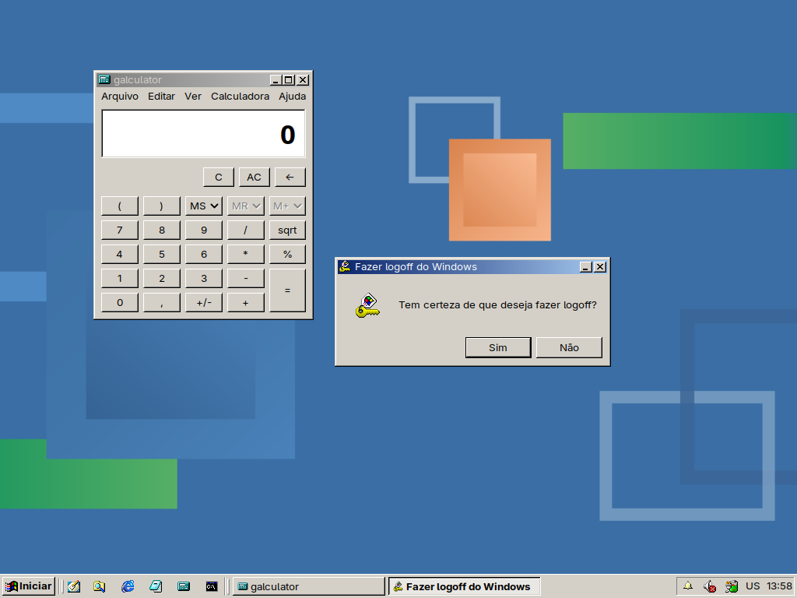
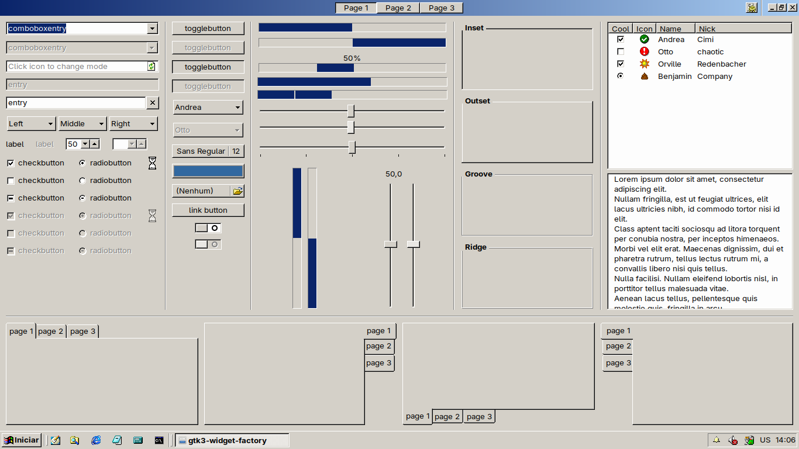
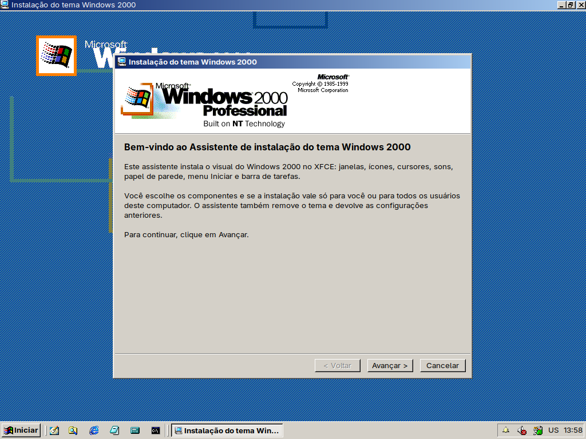
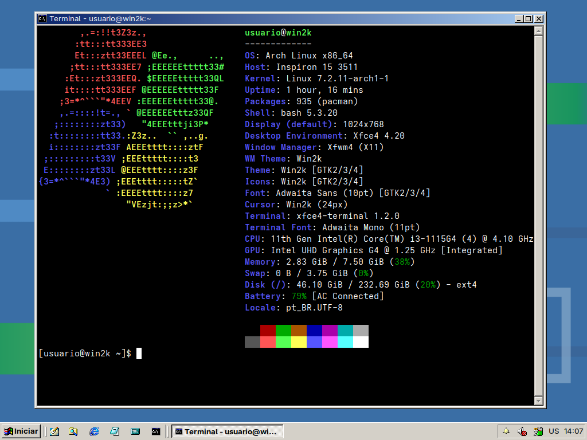
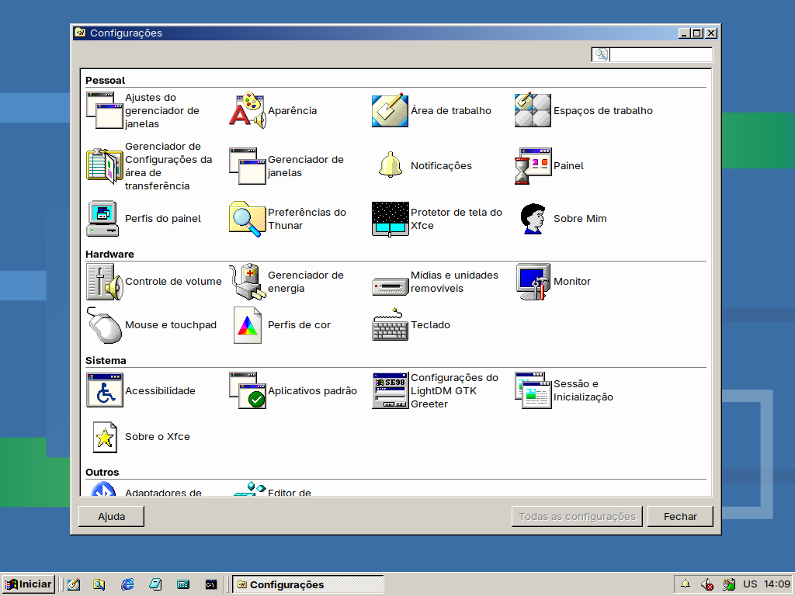
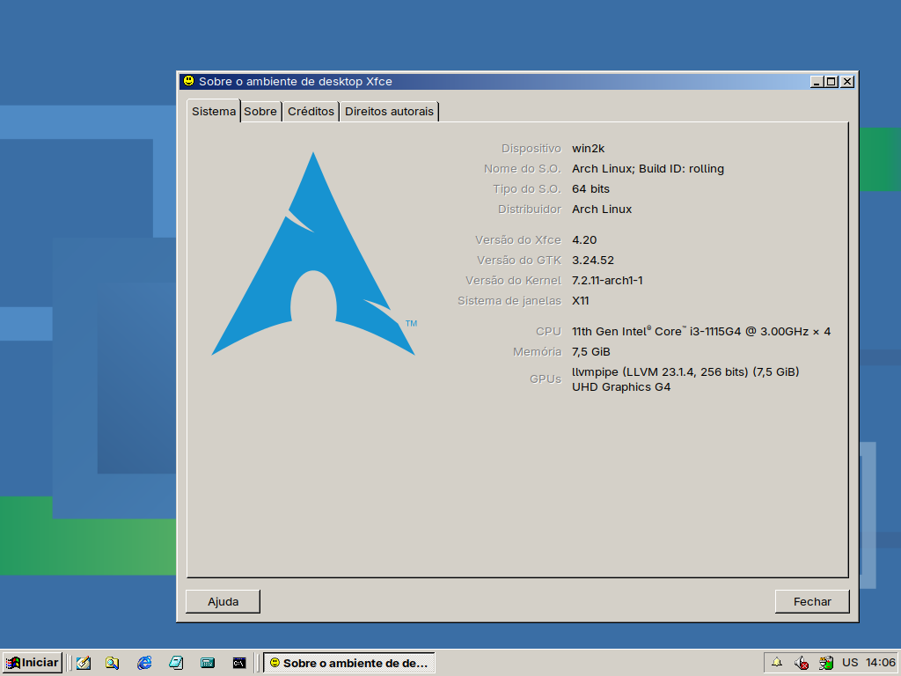
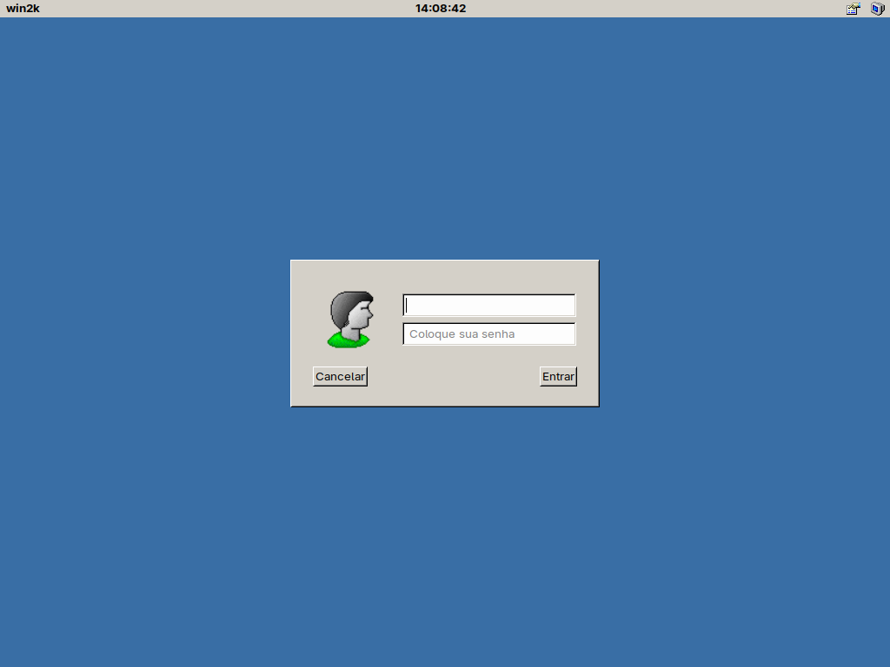

# Win2k — Windows 2000 para XFCE

Tema completo no visual do **Windows 2000 Professional** para o ambiente XFCE no Linux.
Inclui janelas, ícones, cursores, sons, papel de parede, menu Iniciar clássico e barra
de tarefas, além de um instalador gráfico no estilo do Setup do Windows 2000.



📖 **Documentação completa no [wiki](https://github.com/SmileYzn/win2k/wiki)**: instalação, componentes, problemas conhecidos e desenvolvimento.

## Capturas de tela

| | |
|---|---|
|  |  |
| Área de trabalho e barra de tarefas | Menu Iniciar com Programas › Acessórios |
|  |  |
| Thunar e Mousepad | Galculator e o diálogo "Fazer logoff do Windows" |
|  |  |
| Widgets GTK3 (gtk3-widget-factory) | Assistente de instalação |
|  |  |
| Terminal com `fastfetch --logo windows` | Gerenciador de configurações |
|  |  |
| Sobre o ambiente de desktop Xfce | Tela de login (lightdm-gtk-greeter) |

Os principais ícones do pacote estão em [`Icon/icones.html`](Icon/icones.html).

## O que está incluído

| Componente | Pasta | Descrição |
|---|---|---|
| Tema de janelas | `Theme/Win2k` | GTK 2, GTK 3 e GTK 4 (inclusive apps libadwaita), xfwm4 (com versão HiDPI), Openbox, Metacity, Cinnamon, GNOME Shell e notificações do XFCE. Barra de título em degradê, botões em relevo, expansores `[+]`/`[−]` nas árvores. |
| Ícones | `Icon/Win2k` | Pacote de ícones do Windows 2000, baseado no SE98, com nomes extras para apps GTK 4/libadwaita. |
| Cursores | `Cursor/Win2k_Cursors` | Ponteiros do Windows 2000. |
| Sons | `Sound/Win2k` | Esquema "Padrão do Windows": Ding, Chord, Notify, Recycle, logon e logoff. |
| Papel de parede | `Wallpaper/Win2k` | Papéis de parede no estilo Windows 2000. |
| Menu Iniciar | `Menu` | Menu clássico para o plugin "Menu de aplicativos": favoritos, Programas, Documentos (pastas do usuário), Configurações, Pesquisar, Ajuda, Executar, Fazer logoff e Desligar. |
| Painel | `Panel/win2k.tar.bz2` | Barra de tarefas pronta (perfil do xfce4-panel-profiles): botão Iniciar, Inicialização rápida com alça, lista de janelas, área de notificação e relógio. |
| Instalador | `Setup` | Assistente gráfico no estilo do Setup do Windows 2000, com modo de linha de comando. |
| Ferramentas | `tools` | `win2k-sounds.py`: testador do tema de sons. `icon-gallery.py`: gera a galeria `Icon/icones.html`. |

## Requisitos

- XFCE 4.18 ou 4.20 (testado com xfce4-panel 4.20 e xfwm4 4.20)
- GTK 3 e GTK 4
- Python 3 com PyGObject (`python-gobject` no Arch, `python3-gi` no Debian/Ubuntu)
- `xfconf-query` (vem com o XFCE)

Opcionais:

- `xfce4-panel-profiles`, para instalar o painel Windows 2000
- `libcanberra` (`canberra-gtk-play`), para os sons
- `polkit` (`pkexec`), para instalar para todos os usuários
- `gtk-update-icon-cache`, para o cache de ícones

## Instalação

```sh
git clone https://github.com/smileyzn/win2k.git
cd win2k
python3 Setup/win2k-installer.py
```

O assistente pergunta:

1. **O que fazer:** instalar/atualizar ou remover componentes.
2. **Para quem:** *somente para mim* (pasta pessoal, sem senha) ou *todos os usuários* (`/usr/share`, pede a senha de administrador pelo pkexec).
3. **Quais componentes:** cada um pode ser só copiado ou também **aplicado**, isto é, ativado no XFCE na hora.

O painel Windows 2000 vem desmarcado, porque substitui o painel atual. Antes de carregá-lo, o instalador guarda um backup do painel em uso.

### Linha de comando

```sh
python3 Setup/win2k-installer.py --list                      # componentes e onde estão instalados
python3 Setup/win2k-installer.py --install all               # tudo, só para o usuário atual
python3 Setup/win2k-installer.py --install all --system      # tudo, em /usr/share
python3 Setup/win2k-installer.py --install icons,sounds      # só alguns componentes
python3 Setup/win2k-installer.py --install all --with-panel  # inclui o painel Windows 2000
python3 Setup/win2k-installer.py --install theme --no-apply  # copia sem ativar
python3 Setup/win2k-installer.py --uninstall all             # remove e restaura as configurações
```

Componentes: `theme`, `icons`, `cursors`, `sounds`, `wallpaper`, `menu`, `panel`.

### Desinstalação

Escolha **Remover componentes** no assistente, ou use `--uninstall`. As configurações
anteriores do XFCE (tema, ícones, cursor, sons, papel de parede, menu, painel e
`~/.config/gtk-4.0`) são restauradas a partir de `~/.local/share/win2k-installer`.

## Dicas

- **Cursor errado em apps Java e outros:** se `XCURSOR_THEME` estiver definido em
  `/etc/environment` ou `~/.profile`, ele tem prioridade sobre o tema escolhido. Troque o
  valor para `Win2k_Cursors` ou remova a linha e entre de novo na sessão.
- **Seleção arredondada no Thunar 4.20:** desative o destaque com
  `xfconf-query -c thunar -p /misc-highlighting-enabled -n -t bool -s false`.
- **Sons:** precisam de "Habilitar sons de eventos" em *Configurações › Aparência ›
  Configurações*. Para ouvir cada som, rode `python3 tools/win2k-sounds.py`.
- **Apps GTK 4/libadwaita** só usam o tema por `~/.config/gtk-4.0`. O instalador copia o
  tema para lá ao aplicar o componente *Tema*.

## Créditos

- [Chicago95](https://github.com/grassmunk/Chicago95), de grassmunk (GPL-3.0+/MIT): base do tema GTK, xfwm4 e demais temas de janela.
- [SE98](https://github.com/nestoris/Win98SE), de nestoris (GPL-2.0): base do pacote de ícones.
- Sons, cursores, imagens do Setup e faixas do menu Iniciar foram extraídos dos arquivos do
  Windows 2000. **Windows** e **Windows 2000** são marcas da Microsoft Corporation, e esses
  recursos pertencem a ela. Este projeto não tem afiliação com a Microsoft e é distribuído
  apenas para fins de preservação e personalização, sem fins comerciais.

## Licença

O projeto é distribuído sob a [GPL-3.0-or-later](LICENSE), a mesma do Chicago95. O pacote de
ícones (`Icon/Win2k`) mantém a licença do SE98, a [GPL-2.0](Icon/Win2k/LICENSE). Os recursos
do Windows 2000 citados acima pertencem à Microsoft e não são cobertos por essas licenças.
